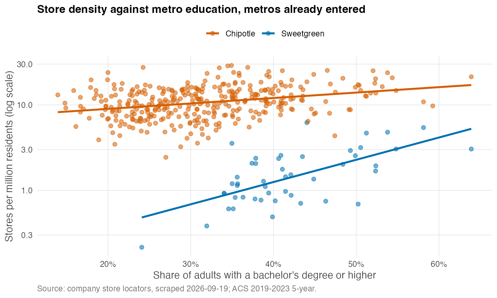
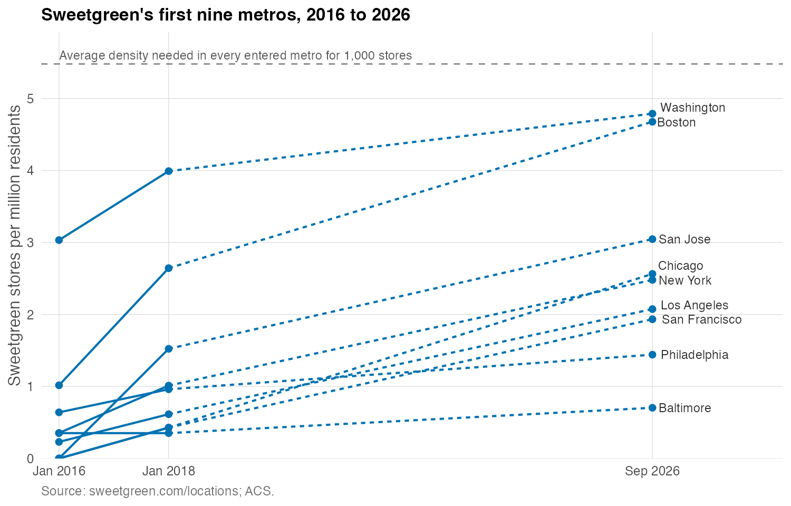

Sweetgreen is an American fast-casual restaurant chain that specializes in
healthy, made-to-order salads, grain bowls and protein plates. On 19 September
2026 its website listed 299 U.S. locations, 292 open and 7 coming soon. In 2022,
its CEO said the company intended to reach 1,000 restaurants by the end of the
decade.[^target]

For a restaurant chain, revenue growth comes mostly from opening new stores, so a fundamental equity
analyst covering Sweetgreen needs to know whether the store count built into the
forecast is realistic. This post asks whether the 1,000 target needs adjusting
and, setting the 2030 deadline aside, where the remaining ~700 restaurants could
plausibly go.

To answer it, I scrape the store locations of Sweetgreen and Chipotle, match
every store to its metro area, and compare where each chain has chosen to open.
Chipotle serves as the control since it's also a fast-casual chain, but it's
much further along with about 4,155 U.S. stores. It separates what matters for Sweetgreen specifically from
what matters for restaurants in general. Because a single snapshot cannot tell a
small market from a young one, I also recover Sweetgreen's store lists from 2016
and 2018 through the Internet Archive and follow its first markets over time.

## Data

Sweetgreen lists its entire store base on one server-rendered page, so a single
request returns all 299 locations. Chipotle publishes a sitemap that encodes the
state and city of each of its 4,155 stores, so two XML files cover all of them.
There are two fixes needed to match stores to metro areas. First, some locations
in cities like Boston loses the leading zero in the ZIP codes. For example, 
02109 appeared as 2109, so we need to recover the correect codes. Second, 
we need to add New York's boroughs and New England's towns, which are not
Census places. After both, 95.7% of Sweetgreen locations and 95.2% of Chipotle
stores match a metro area, and the 280 open Sweetgreen stores in U.S. metros are
the base for everything that follows.

## Sweetgreen Opens in Educated Metros

If Sweetgreen could match Chipotle's density of 13.3 stores per million
residents everywhere, it would support about 3,800 restaurants. That assumes
every metro suits Sweetgreen equally, so I first need to know what kind of metro
Sweetgreen builds densely in. A regression measures how store
density varies with each of a metro's characteristics while holding the others
fixed, and the fitted relationship can then be applied to metros with no stores
yet.

For each chain separately, I regress log stores per million residents on log
median household income, log population density and the share of adults with a
bachelor's degree. These are the questions store managers think about because 
they need to know whether residents can afford it, whether enough people live close
together to support a store, and how many are college-educated. I use only the
metros each chain has entered (47 for Sweetgreen, 353 for Chipotle), because a
metro with no stores has a density of zero and the log of zero is undefined.
Taking logs puts two chains of very different sizes on the same percentage
scale, so each coefficient reads as a percentage change in store density.

Each dot is a metro, and each line is fitted to one chain. Because the vertical
axis is on a log scale, the steeper Sweetgreen line means its density responds
far more to how educated a metro is. A one-percentage-point rise in the
bachelor's share is associated with about 6.6% more Sweetgreen restaurants per
capita, but only about 1.0% more Chipotles, and the two coefficients are roughly
four standard errors apart. Income adds nothing once education
is known. The two move together across Sweetgreen's metros (correlation 0.55),
and income's coefficient is indistinguishable from zero once education is held
fixed.

## New Cities Add Only About 120 Stores

Carrying the fitted relationship to the 340 metros Sweetgreen has not entered
gives about 120 more restaurants, for a total of about 400 (fitting in levels
instead of logs gives 406). The largest opportunities are Portland (about 4
stores), St. Louis (3.5), Orlando (3.4), Pittsburgh (3.2), Kansas City (2.9) and
Cincinnati (2.8). These metros are simply less educated. Their median bachelor's
share is 29.5%, against 40.6% in the metros Sweetgreen serves.

So new cities can supply about 120 of the remaining ~700 restaurants. The rest
would have to come from the 47 metros Sweetgreen already operates in, raising
them to about 880 restaurants, or 5.5 per million residents. That is 3.1 times
their current 1.7, and denser than any large market Sweetgreen runs today.

## Existing Markets Fill In Slowly

Each line follows one of the nine metros Sweetgreen had entered by January
2018. Solid segments connect the two archived store lists, while dashed segments jump
to September 2026, because no list is provided in between. Population is held at
its 2019–2023 level, so every rise is new stores. The grey dashed line is the
5.5 per million the target requires.

The six metros Sweetgreen was in by January 2016 now
average 2.6 stores per million, against 1.1 for the 38 it entered after January
2018. Part of what makes a metro look sparse today is simply that Sweetgreen
arrived recently, so the 400 above is best read as what the footprint supports
at its current stage, not a permanent ceiling.

But even the oldest markets fill in slowly. Washington, where Sweetgreen started
in 2007, went from 25 stores in January 2018 to 30 today. The six oldest metros
together rose from 1.4 to 2.6 stores per million between January 2018 and
September 2026, about 0.15 per million a year. At that pace they would need
roughly another 20 years to reach 5.5.

## Takeaway

The 1,000 target is not a bet on Sweetgreen finding new cities. It is a bet that
its existing markets fill in far faster than its oldest ones ever have.
Sweetgreen's own filings point the same way: it opened 35 net new restaurants in
2025 and 25 in 2024.[^10k] At 35 a year, the roughly 290 restaurants open today
become about 440 by the end of 2030, and 1,000 arrives around 2046, the same
twenty-year horizon the density trajectory gives. Reaching 1,000 by 2030 would
take about 165 net openings a year from here, nearly five times the 2025 pace.

A revenue forecast should therefore use something close to 440 restaurants for
2030 as the base case and treat 1,000 as a long-run ceiling. Two numbers would
justify moving the forecast up: annual net openings rising well above 35, and
density in Washington and Boston continuing to climb past 5 per million, which
would show that even mature markets have room left.

## Caveats

- **Unobserved appeal that is only available to Sweetgreen** Sweetgreen opens where it expects
  high local appeal I
  cannot observe, such as office density, lunch culture and rents.
  The metros it has not entered are probably weaker than their education levels
  alone suggest, so the 120 is more likely too high than too low.
- **A gap in the history.** No archived store list survives between January
  2018 and September 2026, so I cannot tell whether Washington's growth stopped
  in 2019 or slowed gradually. The archived lists are also only as complete as
  the copies the Internet Archive happened to save.

## Data and code

- **Sweetgreen locations:** `sweetgreen.com/locations`, one request,
  19 September 2026.
- **Chipotle locations:** `locations.chipotle.com/sitemap1.xml` and
  `sitemap2.xml`, two requests, same date.
- **Metro population, income and education:** American Community Survey
  2019–2023 5-year estimates, via `tidycensus`.
- **Place, town and metro boundaries:** Census TIGER/Line 2023, via `tigris`.
- **Archived Sweetgreen store lists:** Internet Archive Wayback Machine copies of
  `sweetgreen.com/locations` from 13 January 2016 and 3 January 2018, fetched
  24 October 2026.

**Code:** [github.com/1iiiiii/Web-Scraping-in-R](https://github.com/1iiiiii/Web-Scraping-in-R)
contains the scripts and cached raw responses

[^target]: Restaurant Dive, *Sweetgreen on track for 1K units by 2030 despite profitability challenges*, 11 August 2022. <https://www.restaurantdive.com/news/sweetgreen-1000-restaurants-by-2030/629384/>

[^rb]: Restaurant Business, *Sweetgreen wanted to reach 1,000 units by the end of the decade. It may take a bit longer*, 2026. <https://www.restaurantbusinessonline.com/operations/sweetgreen-wanted-reach-1000-units-end-decade-it-may-take-bit-longer>

[^10k]: Sweetgreen, Inc., *Form 10-K for fiscal year 2025*, U.S. Securities and Exchange Commission. <https://www.sec.gov/Archives/edgar/data/1477815/000162828026012520/sg-20251228.htm>
