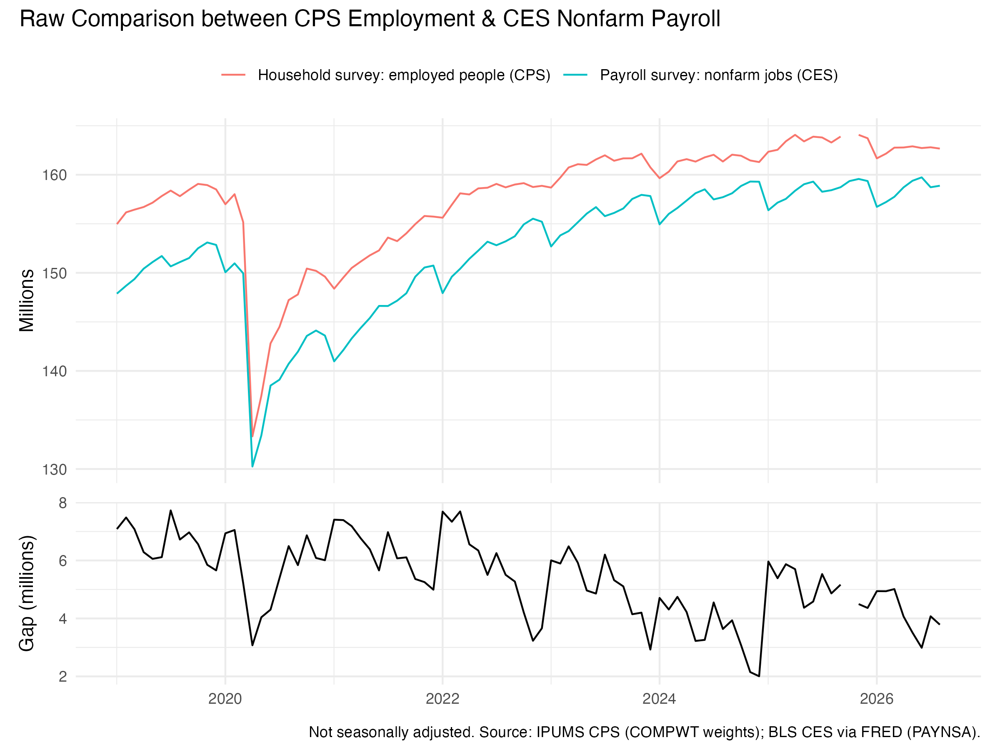
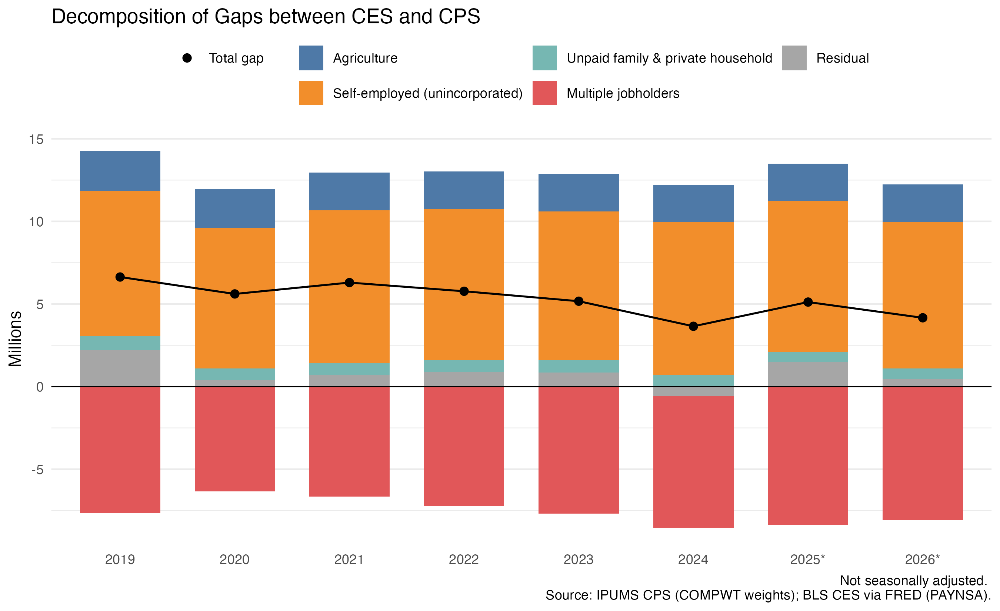
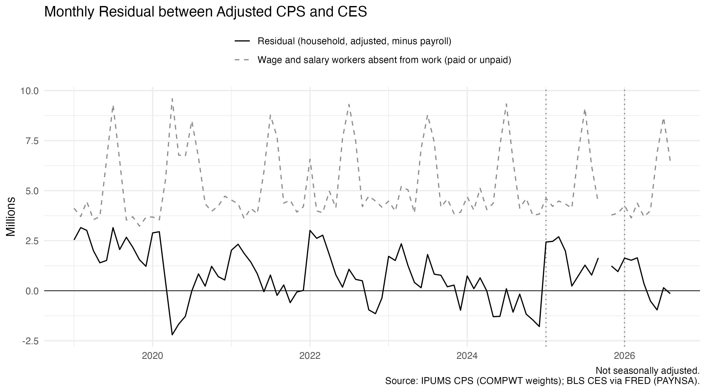

The Bureau of Labor Statistics (BLS) publishes two monthly measures of U.S.
employment. The payroll survey, also known as the Current Employment Statistics (CES), asks
businesses how many jobs they have and produces the nonfarm payroll number from
[my first post](../post1/index.qmd). The household survey, also known as the Current Population
Survey (CPS), asks households whether their members are working.

A problem that the payroll number is facing is that it has become harder to read. The CES response rate hovered
around 60% in the decade before the pandemic and has since fallen below 45%,[^sf]
which makes its early estimates less reliable. As such, analysts, markets and the Fed
increasingly check it against the household survey. But the two don't usually agree. In
2025 the household survey found about 163.5 million employed people, while
payrolls counted about 158.4 million jobs, which is a gap of 5.1 million. Before one
survey can check the other, we need to know what that gap is made of. This post
asks how much of it is simply the two surveys counting different things, and how
much is left over, or the residual.

## Comparison between CPS and CES

| | Household survey (CPS) | Payroll survey (CES) |
|---|---|---|
| Counts | people with a job | jobs |
| Sample | about 60,000 households | about 119,000 businesses and agencies |
| A person with multiple jobs | counted once | counted multiple times |
| Self-employed, unpaid family, private-household workers | counted | not counted |
| Farm workers | counted | not counted |
| On unpaid leave | counted as employed | not counted |

The *unincorporated self-employed* run their own business that is not a
corporation, such as a freelance designer. *Unpaid family workers* work without
pay in a relative's business, and *private-household workers*, such as nannies,
are employed directly by a household.

BLS publishes a recipe, which I will call the *bridge*, for translating one
concept into the other. Starting from household employment ($HE$), I subtract
the groups payrolls exclude: agriculture ($A$), the unincorporated self-employed
($S$), unpaid family workers ($UFW$) and private-household workers ($PHW$). Then
I add back the second jobs of multiple jobholders ($M$). Whatever still separates
the result from payroll jobs ($NFP$) is the residual ($R$):

$$
\underbrace{HE - NFP}_{\text{gap}} \;=\; A + S + UFW + PHW - M + R
$$

The five bridge terms are definitional differences, each estimated from the CPS
microdata. The residual is what the definitions cannot explain, so it is where
at least one survey is off.

## Data and weights

The household data are IPUMS CPS basic monthly microdata from January 2019 to
August 2026. October 2025 is missing because the survey was not collected during
the government shutdown. IPUMS distributes the CPS as one record per person
surveyed rather than as the totals BLS publishes, which lets me build each bridge
category myself. Payroll jobs are total nonfarm employment in their latest
revised version. Both series are *not seasonally adjusted*, meaning the regular
swings within each year, such as holiday hiring, are left in. That is because
the CPS microdata are unadjusted, and both sides have to be on the same basis.

Each respondent carries a *weight*, the number of people they stand in for: a
weight of 2,000 means 2,000 people. I use `COMPWT`, the composite weight BLS uses
for its published estimates. It reproduces BLS's January 2019 employment total
of 154.964 million exactly, while the basic weight `WTFINL` overshoots it by
616,000.

## The gap

The top panel plots each survey's monthly total before any bridging, and the
bottom panel plots the gap between them. The household survey sits above
payrolls in every month. The gap was about 7 million in 2019 and narrowed to
between 2 and 4 million by late 2024. Both series are unadjusted, so the gap
wobbles with the seasons, but the jump of about 4 million between December 2024
and January 2025 is too large to be seasonal. To see what drives a move like
that, the gap has to be decomposed.

## Decomposition by Year: CES vs. CPS

Each bar is the number of people in one bridge category, averaged over the
year. They are measured against a baseline of zero gap, which is what we would see if the
two surveys counted exactly the same thing. Bars above zero are groups only the
household survey counts. The red bar is
second jobs, which only payrolls count, so it pulls the household count back.
The grey bar is the residual, and all the bars add up to the black dot. 
Years with an asterisk are incomplete, since 2025 lacks October due to
government shutdown, and 2026
ends in August.

Definitional differences account for most of the gap in every year: 4.4 of the
6.6 million in 2019, and 3.6 of the 5.1 million in 2025. Self-employment is the
largest single component, usually around 9 million. Second jobs grew from 7.7
million in 2019 to 8.4 million in 2025. Relative to 2019, that offsets 0.7
million more of the household survey's extra workers, which accounts for most of
the 0.8 million fall in the definitional part of the gap.

The grey residual is the more interesting part. It was 2.2 million in 2019,
under 1 million from 2020 to 2023, negative in 2024, and back to 1.5 million in
2025. That swing follows from how the household survey is built. Its weights
are scaled so the sample adds up to the Census Bureau's estimate of the U.S.
population, so a higher estimate raises every weighted count. 
Each January the survey switches to new population estimates and
never revises earlier months. BLS reports that the January 2025 update added 2.0
million to employment relative to the old estimates, mostly because of higher
estimated immigration. My microdata show the same in that household employment usually
falls about 0.8 million from December to January, but in January 2025 it rose by
1.05 million, about 1.9 million more than a typical January.

The update can also move in the other direction. In January 2026, lower
estimated net migration and a Census methodology change cut household employment
by 1.4 million, according to BLS. My decomposition shows a shortfall of about 1.2
million against a typical January.

## Residual Analysis

The solid line is the monthly residual. Above zero, the bridged household count
exceeds payrolls, and below zero, it falls short. Both population updates show up
as jumps at the dotted lines, and the break in late 2025 is the missing October.
The dashed line is a possible explanation the bridge leaves out. Wage and salary
workers who have a job but were absent from work in the survey week.

The residual's largest move, though, is not in a January. Between February and
April 2020 it fell by about 5 million, while absent
wage and salary workers jumped from 3.5 million to 9.6 million. Unpaid
absentees count as employed in the household survey but not on payrolls, so if
they were driving the residual it should have risen. Instead it fell. One
possibility is the payroll survey's reference period. Payrolls count anyone paid
for any part of the pay period that includes the 12th of the month, so workers
laid off after the 12th still appear as jobs. Another is that in-person
household interviews were suspended that spring, so the household survey was
measuring less precisely just when the labor market moved fastest.

## Takeaway

Most of the gap between the two jobs numbers is definitional. After removing self-employment
and farm work (which only the household survey counts) and adding back 
second jobs (which only payrolls count), the two surveys agree to within
about a million in most years. The household survey can therefore check
payrolls, but only after bridging and only once the residual's large moves are
explained.

Those moves have identifiable causes. In 2024 the residual went negative,
meaning the household survey sat too low relative to payrolls, and the January
2025 population update then raised household employment by about 1.9 million
more than a typical January. So at least part of the household survey's weakness in 2024 came
from its population base, not from the labor market. In spring 2020 the residual
also went negative, but there the likelier causes are the payroll survey's
pay-period definition and disrupted household interviews. The practical rule is
to compare the two surveys only after bridging, and to treat a January jump in
household employment as a population revision until shown otherwise.

## Data and code

- **Household survey:** IPUMS CPS basic monthly samples, extract `cps_00003`.
  Sarah Flood, Miriam King, Renae Rodgers, Steven Ruggles, J. Robert Warren,
  Daniel Backman, Etienne Breton, Grace Cooper, Julia A. Rivera Drew, Stephanie
  Richards, David Van Riper, and Kari C.W. Williams. *IPUMS CPS: Version 13.0*
  [dataset]. Minneapolis, MN: IPUMS, 2025. <https://doi.org/10.18128/D030.V13.0>
- **Payroll survey:** BLS Current Employment Statistics, total nonfarm, not
  seasonally adjusted, via FRED (`PAYNSA`), accessed 28 September 2026.
- **Bridge method:** BLS, [Employment from the CPS adjusted to the CES concept](https://www.bls.gov/web/empsit/ces_cps_trends.htm).
- **Population controls:** BLS, [January 2025 adjustments](https://www.bls.gov/cps/methods/population-controls/population-control-adjustments-2025.pdf)
  and [January 2026 adjustments](https://www.bls.gov/cps/methods/population-controls/experimental-series-accounting-for-january-2026-population-control-effects.htm).
- **Code:** [github.com/1iiiiii/Data-Visualization-in-R](https://github.com/1iiiiii/Data-Visualization-in-R).

[^sf]: Federal Reserve Bank of San Francisco, *Do Low Survey Response Rates Threaten Data Dependence?*, Economic Letter, March 2025. <https://www.frbsf.org/research-and-insights/publications/economic-letter/2025/03/do-low-survey-response-rates-threaten-data-dependence/>
