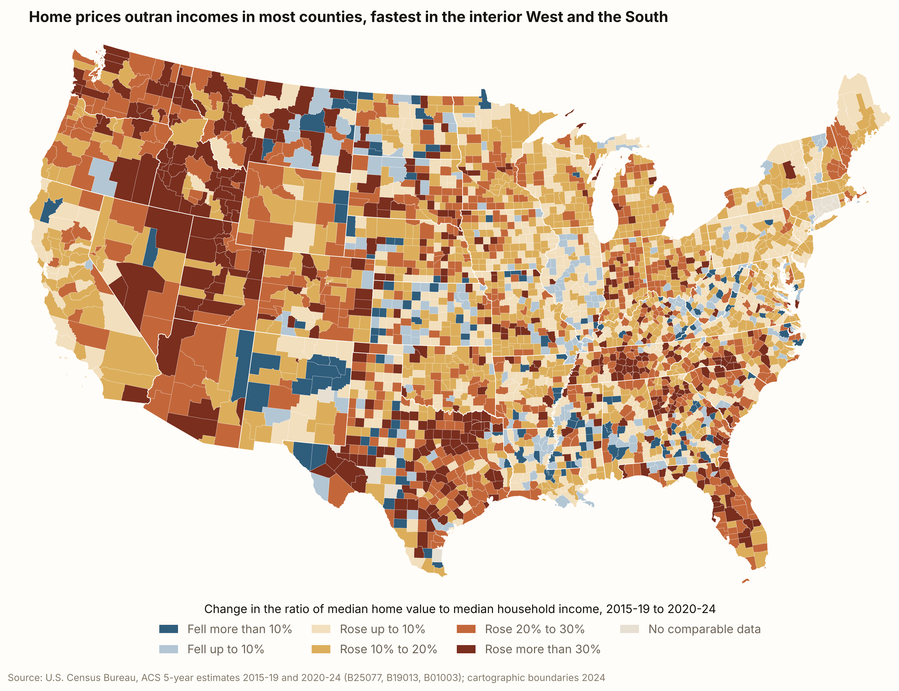
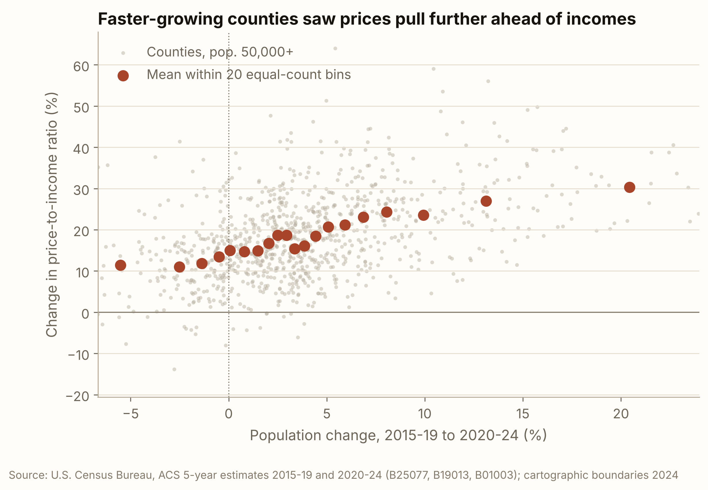

In post 4, we investigated the drivers of increasing mortgage rates, and in this post, we are
delving into the other pillar of housing affordability: housing price. High mortgage rates are
a national story, but housing prices vary significantly from county to county. As such,
using county-level data would give us a more granular perspective of the trend of housing
prices that a national median/average hides.

Looking at home prices alone wouldn't give us a concrete sense of how affordability has
been changing, so we will be using price-to-income ratio. The ratio is the median home
value divided by median household income.
It is a yardstick for how expensive homes are relative to what people earn.
The ratio has increased from 2.9 to 3.5 in the past decade in the typical county with at least
50,000 people, showing a persistent rise in home prices relative to household income.

Rising home prices make it particularly harder for first-time buyers who are saving a
down payment, since the amount of down payment is in proportion to housing prices. This would
also affect employees who are deciding whether to relocate to where their jobs are. It would then
be important for those potential homebuyers to take geography into consideration when deciding
whether and where to purchase a house. This blog post asks: where did home prices
pull furthest ahead of incomes between the late 2010s and the early 2020s, and what do
those places have in common?

## How to measure home price relative to income?

$$\text{price-to-income ratio}=\frac{\text{median home value}}{\text{median household income}}$$

1. Taken at face value, the price-to-income ratio tells us the number of years it would take for a median household income
   to pay for the entirety of the house, which is unrealistic. Therefore, the level
   of the ratio itself matters less than how the ratio moves. This ratio would be the baseline for how we
   measure the changes, and dividing dollars by dollars from the same survey year cancels inflation.

2. We would also be looking at the percent change between two five-year windows, 2015-19 and 2020-24. A 17% rise means
   prices grew about 17% faster than incomes: in the typical county, home values rose 48% and incomes 27%, and 1.48 ÷ 1.27 ≈ 1.17. Percent change is better
   at reflecting the underlying trend. For example,
   the same 10% relative rise would add 0.7 to a
   ratio of 7 but only 0.2 to a ratio of 2, so a level change would make
   places that are already expensive look worse just because they started high. Another benefit of looking at a change
   rather than the ratio itself is that the ratio only
   shows where homes are expensive, while the change shows where affordability got worse.

3. Counties are the finest unit with a reliable median for the whole country. The map shows all
   3,095 continental counties with data, and the comparisons below use the 990 counties with at
   least 50,000 people, where the survey's estimates are steadier.

## Where prices pulled ahead

On an aggregated level, the price-to-income ratio rose in 87% of the counties on
the map, with only 403 of 3,095 counties seeing a fall in the ratio. More strikingly,
96% of people in the mapped counties live in a county where it rose. A cluster
of counties in the interior West (Idaho, Utah,
Nevada, Montana), central and east Texas, Tennessee, Georgia, and Florida, have seen
ratios rise by more than 30% (deepest red on the map).
Coastal California and much
of the Northeast pale in comparison to the deepest reds because while homes there
are expensive, their prices are not outpacing incomes by a significant amount.

Several counties have extreme rises in the ratio. For example, in Clayton County, Georgia, in the southern suburbs of Atlanta,
home values rose 105%, whereas incomes only rose by 25%, so the ratio increased by 64%.
Less extreme rises are Twin Falls (+59%) and Bonneville (+56%) in Idaho, and Hunt County (+50%) in the Dallas exurbs of Texas, but
they still far outpaced the typical county's 17%.
It is noteworthy that every one of these counties started cheap, with ratios of 2.2 to 3.2,
near or below the typical larger county's 2.9.

Nonetheless, there are exceptions. Manhattan's ratio actually fell by 8%,
and in counties whose population mostly shrank or grew slowly, such as in the
rural Southwest, Louisiana and the Ohio valley, incomes grew faster than home values.
What these places share is that people were not moving in.

## What explains the rise

Each grey dot is a county with at least 50,000 people, and each red dot is the average of about
50 counties with similar population growth.
In counties whose population shrank by about 5%, the ratio rose 11%. The fastest-growing twentieth averaged about 20% growth,
and the ratio rose 30%, nearly three times as much.

One likely reason is that during and after the pandemic, people moved toward cheaper,
roomier, warmer places, and housing there could not be built fast enough, so newcomers bid
prices up faster than local incomes rose.

Could it be that places that were already expensive simply pulled further ahead? The data say no.
A county's starting ratio is, if anything, slightly negatively related to how much its ratio rose
(a correlation of −0.12), while population growth is clearly positively related (0.46). Cheaper places
caught up, and where people moved, not where prices already were, predicts the rise. Had we measured
the change in the ratio's level instead of in percent, the starting ratio would have looked positively
related (+0.26), purely because high ratios move more in absolute terms.

## Caveats

- The analysis only reveals the pattern rather than the causes of
  rising home prices. While growth and rising prices move together, other factors
  like climate or cheaper starting prices could drive changes in both.
- The Census home value is what owners estimate their home is worth, not a sale price, and it covers
  owner-occupied homes only, while household income covers all households, renters included.
- Each window is a five-year average, so the 2021-22 price spike is blended in, not shown
  at its peak.
- A county is not a housing market, and a big county can hide a hot town next to a cold one.
  Small rural counties are also noisy in the survey, which is why the map looks speckled in
  the Plains and why the comparisons use counties of 50,000+.

## Takeaway

Since the late 2010s home prices outran incomes in most of the country: by about 17% in the typical larger county,
and by 50% or more in fast-growing suburbs and small cities of the South and the interior West.
The places people moved to saw their price-to-income ratios rise about three times as much
as places that people moved out from, and it was growth, not already-high prices, that predicted the rise.
This suggests that affordability likely hinges on whether
fast-growing places can build, not only on mortgage rates.

## Data and code

| Source | What | Access |
|---|---|---|
| U.S. Census Bureau, American Community Survey 5-year estimates, 2015–19 and 2020–24 | County median home value (B25077), median household income (B19013), population (B01003); 2020–24 also workers and work-from-home (B08006) | Census API, `/data/2019/acs/acs5` and `/data/2024/acs/acs5`, accessed 16 October 2026 |
| U.S. Census Bureau, cartographic boundary files, 2024 | County polygons at 1:500,000 (`cb_2024_us_county_500k`) | Downloaded from census.gov, accessed 16 October 2026 |
