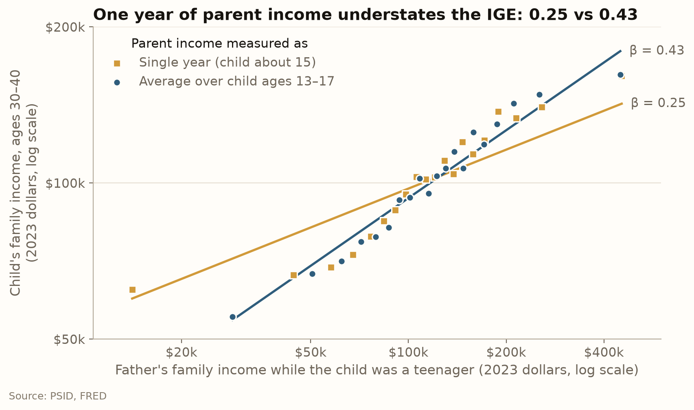
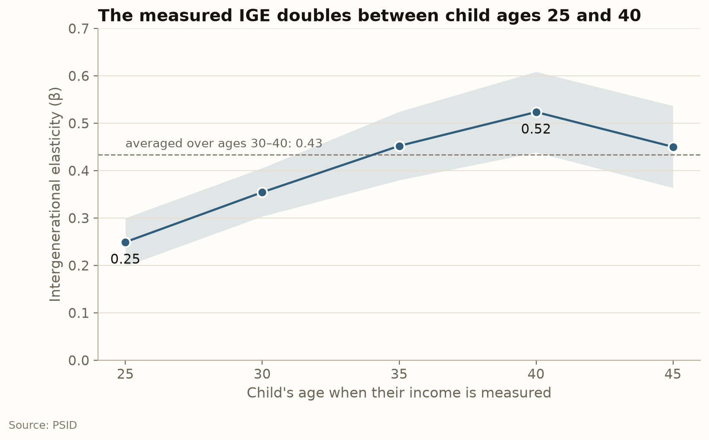

If your parents earned twice what a neighbor's parents earned, how much more will you earn
compared to the neighbor's children? This questions is the motivation for the Great Gatsby curve
and the "American Dream" debate. Policy economists comparing countries and people arguing about
whether the US is a land of opportunity both reach for the same number (the
intergenerational elasticity (IGE)) to answer it. 

Most of the debate is about how big that number is. This post asks a prior question: how much of a
parent's income advantage reaches the children, and does the answer depend on when income is measured?
It does. Measuring a parent's income in a single year, or a child's income too early in their career,
makes the US look more mobile than it is. In the data used here, a single year of the father's income
hides about 40% of the persistence. This post walks through the
whole pipeline, from raw survey file to estimation using SQL inside Python, so a reader with basic Python and SQL can redo it.

## What the intergenerational elasticity measures

Intergenerational elasticity (IGE) measures the link between parents' income and
their children's income after they leave the family. The equation is:

$$
\ln y_{\text{child}} = \alpha + \beta\, \ln y_{\text{parent}} + \varepsilon
$$
It is a log-log regression of child income on parent income, where β is the IGE. A
β of 0.4 means that if one father earned 10% more than another, his children earn 4% more
than the other's children on average. A β of 0 means there is no relationship, and a β of 1 would mean a caste system
where there is no mobility whatsoever.

## Introduction of the data source

The Panel Study of Income Dynamics (PSID) began in 1968 has interviewed the same people, their children, and their grandchildren.
It interviewed them every year until 1997 and every two years since, most recently in 2023. 
Because children are followed when they leave home, the same file contains a father's income in 1985
and his daughter's income in 2015. That is what makes a parent–child match possible.

We rely on two unique identifiers for the match.

- **Every person's permanent ID.** This is the interview number of the family they were first observed in 1968 (for the original
  families) plus a person number within it. It never changes.
- **Interview number each family gets every year.** Income is recorded once per family per year
  under that number, and each member's record carries the same number. So a person's record says "in 1990 I was in family 517",
  and the family record says "family 517 earned $38,400 in 1989".

The raw data downloaded from the Data Center gives one wide spreadsheet , and the first job is to turn it into three tables. 
A table with individuals, a table with one row per
person-year and a table with one row per family-year can be joined on (year, interview number). A wide file
cannot be joined this way, because each year's values sit in a different column. All incomes are converted
to 2023 dollars with the Consumer Price Index (CPI), so a dollar in 1975 and a dollar in 2015 buy the same amount.

| Table | One row per | Rows | Key |
|---|---|---|---|
| `individuals` | person | 85,536 | permanent ID (`id_1968`, `person_num`) |
| `persons` | person × survey year | 910,869 | permanent ID + `year`; `interview`, `age` and relationship to head |
| `families` | family × survey year | 320,456 | `year`, `fam_interview`; total family income (adjusted based on 2023 CPI) |

## Step 1: Filter the children

A child observation is a person-year in which the person becomes the head of their own household
or is the spouse of the head, aged 25–45. 
The relationship filter is needed and
we can't rely on age alone. For example, a 32-year-old still
living with their parents carries the parents' income on their record.

```sql
SELECT id_1968, person_num, year, age, interview
FROM persons
WHERE rel_head IN (1, 2, 10, 20, 22)   -- head or spouse; the codes changed in 1983
  AND age BETWEEN 25 AND 45;
```

SELECT picks columns, FROM chooses the table, and WHERE filters those rows we need. Note that there is
code change in 1983, so 1 and 2 are before 1983 and 10, 20, and 22 are after. Refer to the codebook for more information.
We should get 259,398 persons-years from 34,533 people.

## Step 2: Attach each person-year to its family's income

The JOIN clause lines up rows of two tables that share a key. The key here is (year, interview
number). We should check the row count before and after JOIN. Same count means
nothing was duplicated and every person-year found its family.

```sql
SELECT p.id_1968, p.person_num, p.year, p.age, f.fam_income_real
FROM persons AS p
JOIN families AS f
  ON p.year = f.year AND p.interview = f.fam_interview
WHERE p.rel_head IN (1, 2, 10, 20, 22)
  AND p.age BETWEEN 25 AND 45;
```

We use INNER JOIN here because we want to drop a person-year with no family record.
That is, the family is not interviewed during that year.

## Step 3: JOIN on identifiers to find each child's father

The `individuals` table has the child's own ID in two columns and the father's ID in two other columns.
Joining the table to itself, the child's father columns against the father's own ID columns, is the parent–child match.

```sql
SELECT c.id_1968, c.person_num,
       dad.id_1968, dad.person_num
FROM individuals AS c
LEFT JOIN individuals AS dad
  ON c.father_id_1968 = dad.id_1968
 AND c.father_person_num = dad.person_num;
```

A LEFT JOIN here keeps every child and fills the father columns with NULL when no match
exists, so the NULLs can be counted. Of 34,533 people in the child sample, 24,690 have no
father in the data. Among the 24,690 NULLs, 15,316 was because their parents were never
surveyed, and 9,374 was because the father's ID points to someone not in the extract.
The matched children we get are those whose fathers were PSID members.

We then join the father's ID to his rows in `persons`, and those to `families`, keeping the years when
the child was 13–17. The reason we use a window between 13-17 is that it measures
the family's resources while the child was growing up.
About 70% of the children in the final sample were born by 1980, so they turned 17 before the survey
became every two years.

```sql
SELECT c.id_1968, c.person_num,
       fp.year, fp.year - b.birth_year AS child_age,
       f.fam_income_real
FROM individuals AS c
JOIN birth    AS b  ON b.id_1968 = c.id_1968 AND b.person_num = c.person_num
JOIN persons  AS fp ON fp.id_1968 = c.father_id_1968
                   AND fp.person_num = c.father_person_num
JOIN families AS f  ON f.year = fp.year AND f.fam_interview = fp.interview
WHERE fp.year - b.birth_year BETWEEN 13 AND 17;
```

Here `birth` is a small helper table with each person's birth year, computed from their age in each survey year.

## Step 4: Comparing one year of income with several years

After JOINing, we then aggregate the data to get the income information we want.
GROUP BY collapses many rows per child into one, and we are grouping by two
identifiers, and the two together identify one person.
AVG takes the mean and COUNT gives the number of rows. We build two parent
income measures. The first is the single year when the child was closest to 15, and 
the second is the average over the observed years at ages 13–17.
We require at least two observed years, so both measures use the same 3,951 children. That way, any gap
between the two estimates comes from how income is measured, not from comparing different families.

```sql
SELECT id_1968, person_num,
       AVG(fam_income_real) AS parent_inc_avg,
       COUNT(*)             AS parent_years
FROM father_income
GROUP BY id_1968, person_num;
```

## Result 1: One year of parent income understates the IGE



Each dot is the average child income among about 200 children whose fathers had similar incomes, and the
lines are regression fits. Both axes are on a log scale, so each line's slope is β. Gold uses the father's
income in the single year the child was about 15, and blue uses the same fathers' average over the child's ages 13 to 17.

Averaging raises the IGE from 0.25 to 0.43 for the same children, so the single-year measure understates it by
about 40%. A single year's income is long-run income plus that year's luck, such as a bonus or a layoff, and
the luck flattens the line toward zero. Averaging cancels much of it (Solon 1992).

## Result 2: Age when the children's income is measured



Each point is the same regression, with parent income averaged over the child's ages 13 to 17 but the child's
income measured in a single year at the age on the horizontal axis. The band is the 95% confidence interval,
and the dashed line is the estimate from Result 1, which averages the child's income over ages 30 to 40.

The IGE rises from 0.25 at age 25 to 0.52 at 40, then falls to 0.45 at 45. At 25, many children of high-income
parents are still in school or early in steep careers, so their income that year understates their lifetime
income more than it does for other children (Haider and Solon 2006). Fewer children are observed at older
ages (3,753 at 25, 1,881 at 45), so part of the pattern may reflect who is in each group.

## Takeaway

In the PSID, a father's income averaged over his child's teenage years gives an IGE of 0.43. A father who
earned 10% more than another has children who earn about 4.3% more in their 30s. The two results show two
different problems, and both push the estimate down. A single year of the father's income mixes long-run income
with temporary luck, which averaging fixes (0.25 rather than 0.43). A child's income at 25 understates their
lifetime income, which measuring near mid-career fixes (0.25 at 25 rather than 0.52 at 40). A multi-year
average is the better measure of long-run economic status because the temporary ups and downs cancel while the
persistent level stays. Finally, to answer the opening question. If your parents earned twice as much as your neighbor's,
you would expect to earn about 35% more than the neighbor's children (2^0.43^ ≈ 1.35), not the 19%
(2^0.25^ ≈ 1.19) that a single-year measure suggests.

## Data and code

| Source | What | Access |
|---|---|---|
| Panel Study of Income Dynamics (PSID), public-use data, 1968–2023 | Individual file: permanent person ID, sex, father's and mother's IDs, and per wave age, interview number, relationship to head, sequence number. Family files: family interview number and total family money income | PSID Data Center custom extract |
| U.S. Bureau of Labor Statistics, CPI-U all items (CPIAUCSL), via FRED | Annual-average CPI used to express all incomes in 2023 dollars (PSID income in survey year *t* refers to calendar year *t* − 1) | FRED CSV endpoint, accessed 23 October 2026 |


Code, the SQL, and every number in this post: [github.com/1iiiiii/Intergenerational-Mobility](https://github.com/1iiiiii/Intergenerational-Mobility).

## References

- Haider, S. and G. Solon (2006). "Life-Cycle Variation in the Association between Current and Lifetime Earnings." *American Economic Review* 96(4): 1308–1320.
- Solon, G. (1992). "Intergenerational Income Mobility in the United States." *American Economic Review* 82(3): 393–408.
